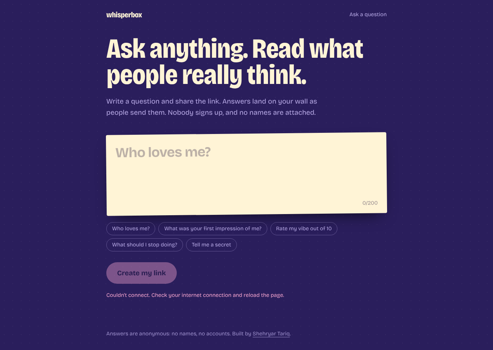
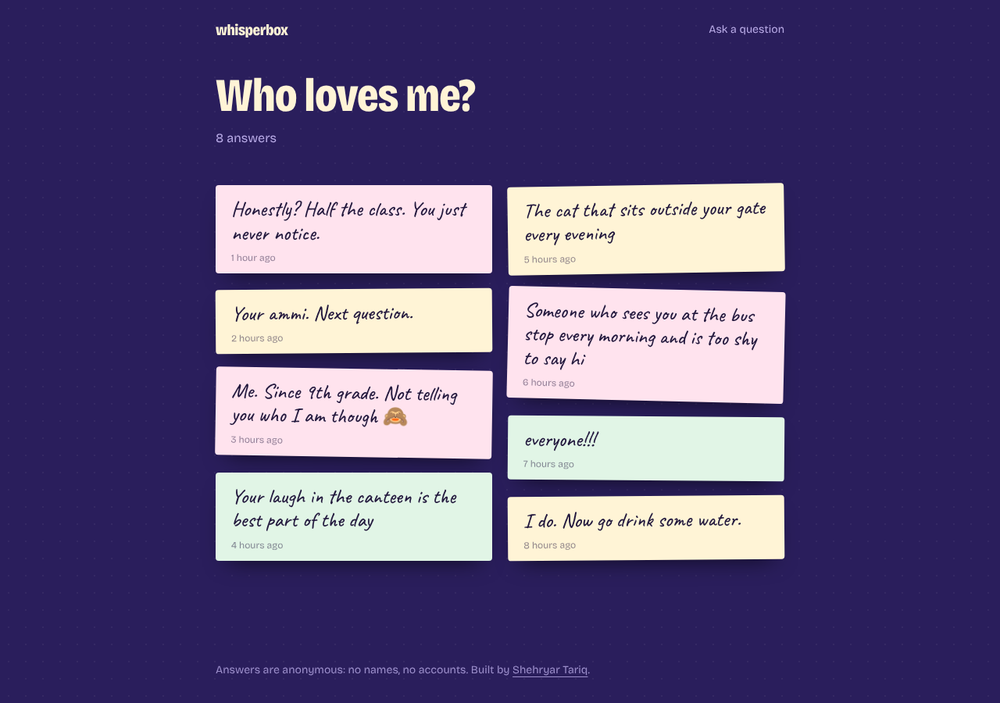
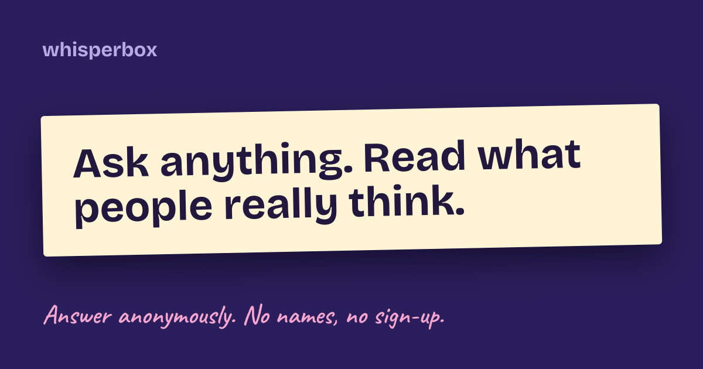

# Whisperbox

Ask a question, share the link, and read anonymous answers as they arrive. Nobody signs up: not you, and not the people who answer.

**Live:** https://getwhisperbox.vercel.app



## How it works

1. Write a question, for example "Who loves me?", and press **Create my link**.
2. Share the link on WhatsApp, Instagram, or anywhere else.
3. People open the link and answer. Their answers drop onto your wall in real time, with no names attached.
4. From the browser that asked the question, you can close it to new answers, delete answers, or delete the whole question.



Shared links get a preview image that shows the question:



## Tech stack

- **Next.js 16** (App Router, Cache Components) with **TypeScript** and **Tailwind CSS 4**
- **Firebase**
  - **Cloud Firestore** for questions and answers, with live updates through `onSnapshot`
  - **Anonymous Authentication**: every browser is signed in silently. Nobody types anything, but the browser that created a question can manage it.
- **Firestore security rules** do the protecting, because the app has no backend of its own
- **Vitest** + `@firebase/rules-unit-testing` for the rules, **Playwright** for end-to-end tests, both against the Firebase emulators in GitHub Actions

## How the data stays safe

All the rules live in [`firestore.rules`](firestore.rules) and are covered by [tests](tests/rules/firestore.rules.test.ts).

- **Answers are anonymous.** An answer stores only its text and time. No user ID, IP address, or device info.
- **Only the asker can manage a question.** Closing it, deleting answers, and deleting the question all check that the request comes from the browser that created it.
- **Nothing can be edited after posting.** Answers can't be changed, and a question's text can't either.
- **Rate limits.** One question every 30 seconds and one answer every 10 seconds per browser. Each write stamps a private `limits/{uid}` document in the same batch, and the rules reject a write that comes too soon.
- **Input checks.** Questions are 3–200 characters, answers 1–500, and unknown fields are rejected.

## Run it locally

Requirements: Node 22, pnpm, and Java 21 (only for the Firebase emulators).

```bash
pnpm install
cp .env.example .env.local
```

**Option A: no Firebase project needed.** Set `NEXT_PUBLIC_FIREBASE_EMULATOR=true` in `.env.local`, then:

```bash
pnpm emulators   # terminal 1: local Auth + Firestore with the real rules
pnpm dev         # terminal 2: http://localhost:3000
```

**Option B: your own Firebase project.** Fill in the `NEXT_PUBLIC_FIREBASE_*` values (see below) and run `pnpm dev`.

### Tests

```bash
pnpm lint && pnpm typecheck
pnpm test:rules    # security rules against the Firestore emulator
pnpm build && pnpm test:e2e   # full flow in two browsers (build with the emulator setting on)
```

## Set up Firebase

1. Create a project in the [Firebase console](https://console.firebase.google.com/).
2. **Build → Authentication → Get started → Sign-in method → Anonymous → Enable.**
3. **Build → Firestore Database → Create database** (production mode, any region).
4. **Firestore → Rules:** paste the contents of `firestore.rules` and publish. Or run `pnpm exec firebase deploy --only firestore:rules --project <project-id>`.
5. **Project settings → Your apps → Web app.** Copy `apiKey`, `authDomain`, `projectId`, and `appId` into the `NEXT_PUBLIC_FIREBASE_*` variables. These values are public by design. The rules protect the data.
6. On Vercel, add the same variables, plus `NEXT_PUBLIC_SITE_URL` set to the live URL. Then add that domain under **Authentication → Settings → Authorized domains**.

## Project structure

```
src/app/page.tsx                    Ask a question, and see your previous ones
src/app/q/[id]/page.tsx             The question page (server shell + live wall)
src/app/q/[id]/opengraph-image.tsx  Link-preview image
src/components/                     Ask form, reply form, share panel, answer wall
src/lib/whisper.ts                  All Firestore reads and writes
src/lib/limits.ts                   Length and rate limits (mirrored in firestore.rules)
firestore.rules                     Security rules
tests/                              Rules tests (Vitest) and end-to-end tests (Playwright)
```

## Ideas for later

- AI moderation that holds back abusive answers before they're shown
- Turn an answer into an image for Instagram stories
- Firebase App Check to block scripted spam
